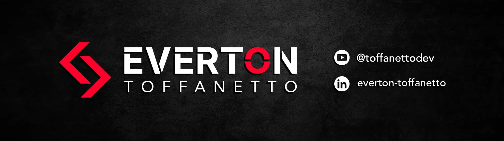

  

---

  <h2 align="center">Hi, I'm Éverton</h2>

AI Engineer. I build AI agents, agent harnesses, RAG pipelines and MCP servers, and the full-stack products around them.
 

Postgraduate student in Generative AI Engineering (Data Science Academy, 2026–2027), with 10+ years shipping web applications in React, Next.js, TypeScript, Node.js and Python.

---

<h2 align="center">What I work with</h2>

- **Applied AI:** LLMs, AI agents, agent harnesses, RAG, MCP, LangGraph, OpenAI API, embeddings, vector search, LanceDB
- **Full stack:** Python, Node.js, REST APIs, BFF, Docker, CI/CD
- **Frontend:** React, Next.js, SolidJS, TypeScript, Tailwind CSS, Vite
- **Quality and architecture:** Vitest, Playwright, Testing Library, Clean Architecture, DDD

---

<h2 align="center">Featured projects</h2>

- **[vault-search-mcp](https://github.com/everton-dgn/vault-search-mcp)** - Python MCP server for hybrid search (vector + full-text on LanceDB, reranking, graph navigation) across Obsidian vaults and Markdown knowledge bases.
- **[llm-router](https://github.com/everton-dgn/llm-router)** - local LLM router for OpenCode, with adaptive routing across MiniMax, GLM, Claude and Codex and configurable tool policies.
- **[generate-commit-extension](https://github.com/everton-dgn/generate-commit-extension)** - VS Code and VSCodium extension that writes Conventional Commits from your staged diff using LLM providers.
- **[carreira-guiada](https://github.com/everton-dgn/carreira-guiada)** - agent workflow in Python that automates the job search: ATS résumé, job matching, form filling, applications and e-mail follow-ups, running on Claude Code, Codex CLI or the model you prefer.
- **[content-lens](https://github.com/everton-dgn/content-lens)** - local-first browser extension that filters algorithmic feeds with explainable rules, plus opt-in AI classification and AI-assisted rule creation.
- **[cdxt](https://github.com/everton-dgn/cdxt)** - interactive on/off toggle for MCP servers and plugins in the Codex CLI config.

---

<h2 align="center">Open source contributions</h2>

Merged contributions to OpenCodex, oh-my-pi and Paseo: model configuration, provider usage and quota queries, and coding agent integration.

---

<h2 align="center">Contact</h2>

 

  
  
  

